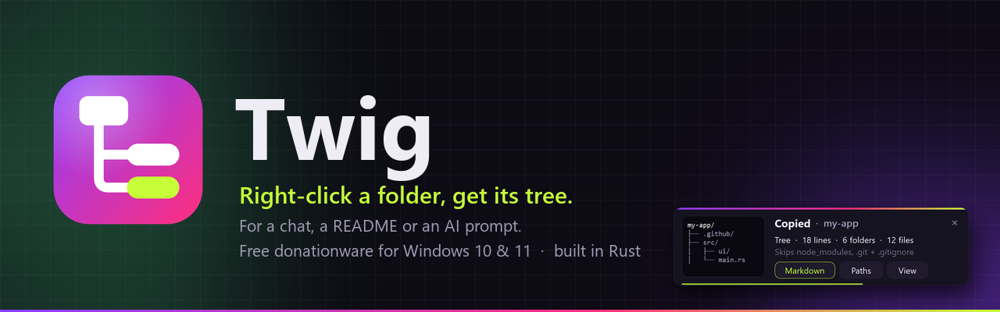
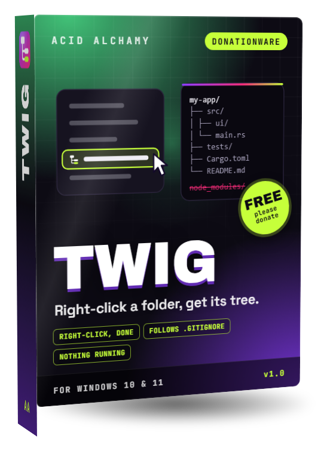
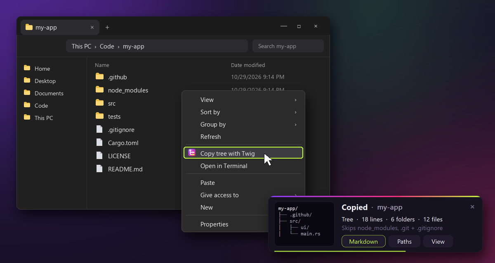
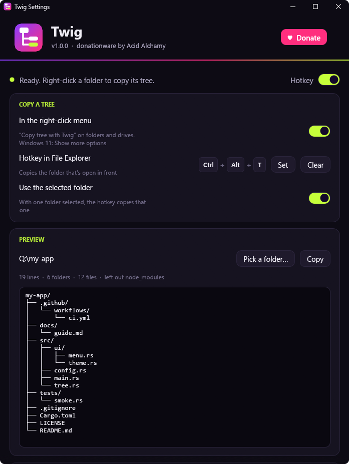
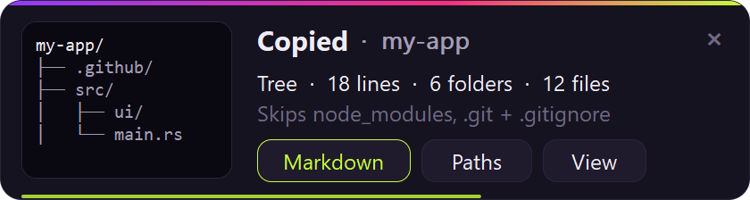

<div align="center">

<a href="https://acidalchamy.com/donationware/twig/"></a>

<br>

<a href="https://github.com/AcidAlchamy/twig/releases/latest/download/Twig.exe"></a>
&nbsp;
<a href="https://acidalchamy.com/donationware/twig/?from=github#donate"></a>

<br><br>

<a href="https://github.com/AcidAlchamy/twig/releases/latest"></a>


</div>

<br>

<table>
<tr>
<td width="44%" valign="top" align="center">

</td>
<td valign="top">

### Right-click a folder, get its tree.

Right-click any folder in File Explorer, choose **Copy tree with Twig**, and its structure is on your
clipboard as a clean tree, ready to paste into a chat, a README, an issue or an AI prompt.
It follows **.gitignore** the way Git does and always skips `node_modules` and `.git`, so you get the
project and not the noise.

With Twig in the tray, <kbd>Ctrl</kbd>+<kbd>Alt</kbd>+<kbd>T</kbd> does the same for the folder that's
open in front: the tab you're on, or the one folder you've selected.

**Built light, on purpose: that's why it exists.** Twig is one 5.7 MB exe with no installer, and no
shell extension: nothing is loaded into Explorer. The right-click starts Twig, copies, and it's gone.
Kept in the tray for the hotkey, it sleeps at **0% CPU** in about **3 MB** of memory.

**Twig is donationware.** It's free to use, for good: no trial, no locked features, no account.
If it saves you some typing, a [small donation](https://acidalchamy.com/donationware/twig/?from=github#donate)
keeps the lab building more tools like it.

</td>
</tr>
</table>

---

## ✦ What you get

Right-click `my-app`, paste:

```text
my-app/
├── .github/
│   └── workflows/
│       └── ci.yml
├── src/
│   ├── ui/
│   │   └── menu.rs
│   ├── config.rs
│   └── main.rs
├── tests/
│   └── smoke.rs
├── .gitignore
├── Cargo.toml
└── README.md
```

`node_modules/` is on the skip list, and `build/` and `.env` are in the project's `.gitignore`, so none of them
made it in. Folders come first, names in natural order (`file2` before `file10`).

## ✦ What it does

| | |
|---|---|
| **Featherweight** | No shell extension, nothing loaded into Explorer: the menu entry is a few registry keys that start Twig, which copies and exits. In the tray for the hotkey it waits at **zero CPU** in about **3 MB**. |
| **Right-click, done** | **Copy tree with Twig** on folders, on the empty space inside a folder (copies that folder) and on drives. On Windows 11 it's under *Show more options*, or hold <kbd>Shift</kbd> as you right-click. |
| **The folder as Git sees it** | `.gitignore`, `.ignore` and Git's own excludes are followed the way Git does (via ripgrep's [`ignore`](https://crates.io/crates/ignore) crate), in a repo or not. `node_modules`, `.git`, `__pycache__`, `.venv` and friends are always left out; the list is yours to change, `*` works. |
| **A hotkey in Explorer** | <kbd>Ctrl</kbd>+<kbd>Alt</kbd>+<kbd>T</kbd> copies the folder that's open in front. It knows which tab you're on, and with one folder selected it copies that one. |
| **Three ways to write it** | **Tree** like the `tree` command draws it, **Markdown** (the same tree in a ```` ```text ```` block, so READMEs, GitHub and Discord keep it lined up), or **Paths**, one per line (`src/main.rs`) for scripts and AI prompts. |
| **Made for pasting** | Long folders are cut to *"… 312 more files"*, a line limit keeps a huge tree in check, and there's depth, folders-only and file sizes when you want them. |
| **A card, not a pop-up** | A small card shows the top of the tree, the counts and what was left out, with buttons to copy it again **as Markdown** or **as paths**, or **View** it whole. It never takes the keyboard and leaves by itself. |
| **A live preview** | The settings show a real folder's tree as you change them, so you know what you'll paste before you paste it. |

<p align="center"></p>

<p align="center"><sub>A made-up project: the menu and the window are drawn for this picture; the card is drawn by Twig's own code.</sub></p>

## ✦ A look inside

<table>
<tr>
<td width="50%" valign="top"></td>
<td valign="top">

**Settings** (left-click the tray icon, or run `Twig.exe` again):

- **Copy a tree**: the right-click entry on or off, the hotkey, and whether a selected folder wins.
- **Preview**: any folder's tree with your settings, live, and a **Copy** button.
- **What goes in**: `.gitignore`, dot and hidden files, folders only, sizes, how deep, how long a folder may get, and the always-skip list.
- **How it's written**: *Tree*, *Markdown* or *Paths*, and a line limit.
- **Behavior**: *Start with Windows*, the card, the hello note, and taking Twig out of Windows again.

Every change saves on its own; there's no Save button.

<br>

**The card** after each copy (it fades away after five seconds, or stays while you point at it):



</td>
</tr>
</table>

## ✦ Get started

1. **[Download `Twig.exe`](https://github.com/AcidAlchamy/twig/releases/latest/download/Twig.exe)**, put it somewhere it can stay (a tools folder, Documents) and run it. There's nothing to install.
2. Windows may say it doesn't recognize the publisher yet (Twig isn't code-signed). Choose **More info**, then **Run anyway**.
3. Twig adds **Copy tree with Twig** to the right-click menu, settles into your tray and opens its settings once to say hello.
4. Right-click any folder, choose **Copy tree with Twig** (Windows 11: *Show more options* first), and paste it anywhere.
5. Want the hotkey every time? Turn on **Start with Windows** in the settings.

Moved `Twig.exe`? Run it once from its new place and the menu entry follows it.

### The tray menu

Right-click the icon: **Copy a folder's tree…** (pick any folder) · **Copy "my-app" again** · **Pause the hotkey** · **Settings…** · **Donate ♥** · **Twig on the web** · **Quit Twig**.
Left-click opens the settings.

### Command line

```
Twig.exe --copy "D:\Code\my-app"     copy a folder's tree (what the menu entry runs)
Twig.exe --settings                  the settings window
Twig.exe --uninstall                 out of the right-click menu and start-up, settings removed
```

### System requirements

| | |
|---|---|
| **System** | Windows 10 or 11, 64-bit |
| **Processor** | Anything that runs Windows 10 |
| **Memory** | None for the right-click (Twig copies and exits); about 3 MB in the tray |
| **Disk** | One 5.7 MB file |
| **Graphics** | OpenGL 2 for the settings window (any GPU from the last decade) |
| **Displays** | Any number, any mix of scaling (per-monitor DPI aware) |

## ✦ Light, measured

Light is the point of Twig, so here are the numbers, read from Windows' own counters on a 2019 ThinkPad
(i5-10310U, Windows 11 24H2):

| | |
|---|---|
| The right-click | starts, copies, exits: **nothing stays running** |
| Waiting in the tray for the hotkey | **0% CPU**: about 0.7 M CPU cycles in 10 seconds |
| Private memory at rest | **3.1 MB** |
| Handing a folder to the tray copy | **122 ms** from click to done |
| The exe | **5.7 MB**, one file, no installer |

How it stays that light:

- The menu entry is plain registry keys under `HKCU\Software\Classes` (folders, folder backgrounds, drives) that run `Twig.exe --copy "%V"`. No shell extension DLL, so nothing of Twig's is ever loaded into Explorer.
- If Twig is already in the tray, `--copy` hands the folder over with one `WM_COPYDATA` and exits; otherwise it does the copy itself, shows the card, and exits when the card is gone.
- The tray part is plain Win32: a hidden window with one `RegisterHotKey`, blocked in `GetMessage` until the key is pressed. No hooks, no polling, no timers while it waits.
- The hotkey asks Explorer which folder it shows over COM (`IShellWindows` → the active tab's `IShellBrowser` → `IFolderView2`), the same interface Explorer's own scripting uses.
- Folders are walked on a short-lived thread, capped at 100,000 entries; the card is drawn by Twig's own little renderer, and the settings window is a separate, short-lived process of the same exe (egui).

## ✦ Settings file

Everything lives in `%APPDATA%\Twig\settings.toml` (the settings window writes it; you can edit it by hand, then choose *Settings* in the tray to reload).

| Key | Default | Meaning |
|---|---|---|
| `hotkey` | `"Ctrl+Alt+T"` | The Explorer hotkey; empty for none |
| `paused` | `false` | The hotkey does nothing (the right-click entry still works) |
| `use_selection` | `true` | With one folder selected, the hotkey copies that one |
| `style` | `"tree"` | `tree`, `markdown` or `paths` |
| `gitignore` | `true` | Follow `.gitignore`, `.ignore` and Git's excludes |
| `hidden` | `true` | Include dot files and hidden files |
| `skip` | `.git`, `node_modules`, … | Names always left out, anywhere in the tree; `*` works |
| `folders_only` | `false` | Just the folders |
| `sizes` | `false` | File sizes after each file |
| `depth` | `0` | Levels below the folder; `0` is all the way down |
| `per_folder` | `40` | Entries shown per folder before *"… N more"*; `0` for no limit |
| `max_lines` | `1000` | Lines in all before *"… N more lines"*; `0` for no limit |
| `card` | `true` | The card after each copy |
| `hello_card` | `true` | The donationware note when Twig starts |

## ✦ Build it yourself

```
git clone https://github.com/AcidAlchamy/twig
cd twig
cargo build --release      # target/release/twig.exe
cargo test
```

Needs Rust 1.85 or newer and the MSVC build tools. The art is reproducible: `python art/icons.py` renders the icons
(Chrome or Edge + Pillow), `cargo test demo -- --ignored` with `TWIG_DEMO=art/build` draws the card with Twig's own
code, and `python art/readme.py` builds these pictures. `tools/live-test` drives a real Twig on a test PC (the
right-click command, the hand-off, the hotkey with tabs and selection, a drive root, the card's buttons, idle cost,
uninstall) and compares what lands on the clipboard with the expected trees.

## ✦ Donationware

Twig is free and open source under the [MIT license](LICENSE). Use it at home, at work, on every PC you own.
If it saves you some typing, please consider a [donation](https://acidalchamy.com/donationware/twig/?from=github#donate):
it's what pays for the next tool on the [Donationware shelf](https://acidalchamy.com/donationware/).

<div align="center">
<br>
<sub>Made by <a href="https://acidalchamy.com">Acid Alchamy</a> · see also <a href="https://github.com/AcidAlchamy/nab">Nab</a>, the screenshot tool, and <a href="https://github.com/AcidAlchamy/shook">Shook</a>, the mouse finder</sub>
</div>
